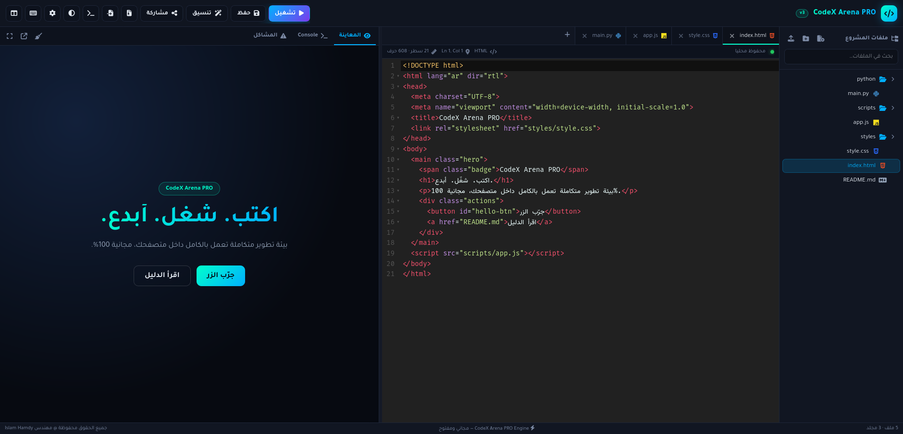
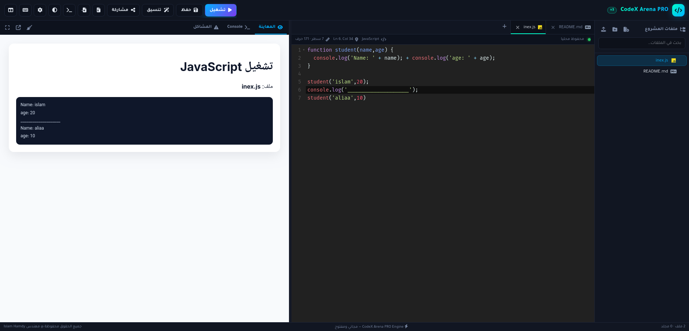

<div align="center">

# 🚀 CodeX Arena

**A modern, responsive web-based code editor and execution engine featuring a Cyberpunk Neon Glassmorphism UI.**

[](https://codex-arena-iota.vercel.app/)
[](https://github.com/Islam412/CodeX-Arena/tree/main)

[Live Demo](https://codex-arena-iota.vercel.app/) · [Report Bug](https://github.com/Islam412/CodeX-Arena/issues) · [Request Feature](https://github.com/Islam412/CodeX-Arena/issues)

</div>

---

## 📸 Preview

## Html Css JS


## JS


---

## ✨ Features

- **🎨 Cyberpunk Neon Glassmorphism UI:** A futuristic interface built with semi-transparent frosted glass textures and vibrant glowing accents.
- **📁 Drag-and-Drop File System:** Organize, create, and manage your project files easily with an intuitive sidebar layout.
- **🔍 Fast Search & Tree Filtering:** Search through your files instantly using quick search filters.
- **⚡ Smart Autocomplete & Syntax Highlighting:** Enhanced code editing experience with autocomplete and contextual code hints.
- **🛠️ Built-in Developer Tools:** Interactive JavaScript Console (REPL) and DOM inspector to inspect output and debug code in real time.
- **🖱️ Custom Context Menus:** Native-feel right-click menus for quick file operations (Rename, Delete, Create).

---

## 🛠️ Tech Stack

- **Frontend:** HTML5, CSS3, JavaScript (ES6+)
- **Styling:** Custom CSS (Glassmorphism, Neon Glow Effects) / Tailwind CSS
- **Deployment & Hosting:** Vercel

---

## 🚀 Getting Started

Follow these steps to run the project locally on your machine:

### Prerequisites

All you need is a modern web browser (Chrome, Firefox, Edge, Safari).

### Installation

1. **Clone the repository:**
   ```bash
   git clone https://github.com/Islam412/CodeX-Arena.tree/main.git
   ```

2. **Navigate to the project directory:**
   ```bash
   cd CodeX-Arena
   ```

3. **Open the project:**
   Simply open `index.html` in your browser, or launch it using VS Code's **Live Server** extension.

---

## 🌐 Live Demo

Check out the live interactive app here:  
👉 **[https://codex-arena-iota.vercel.app/](https://codex-arena-iota.vercel.app/)**

---

## 🤝 Contributing

Contributions, issues, and feature requests are welcome!  
Feel free to check out the [issues page](https://github.com/Islam412/CodeX-Arena/issues).

---